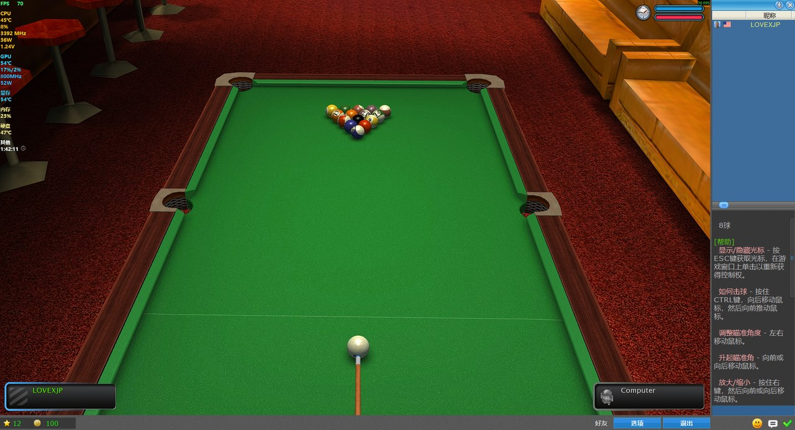
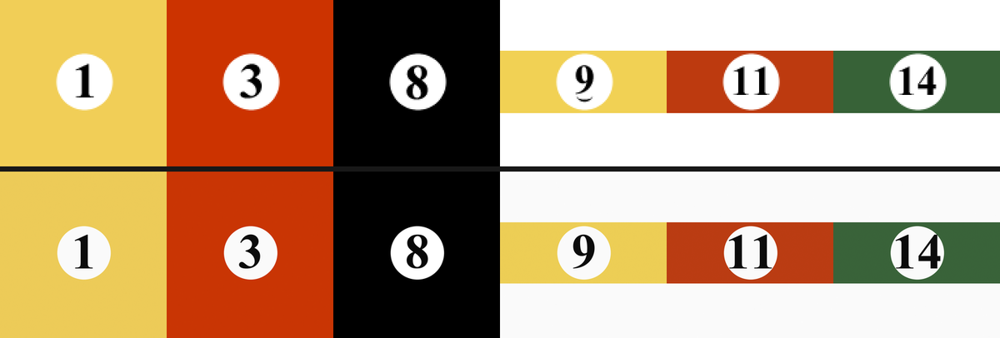

# Real Pool 3D · HD 材质重制工具

把 **Poolians《真实台球3D》(Real Pool 3D, Steam AppID 670290)** 的贴图分辨率拉高一个时代：
球贴图从 128×128 重绘到 512×512，台布/球房贴图 2–8 倍超分，球体材质补上原版没有的高光。

> **非官方 mod**，与 Poolians 无关。游戏本体与原始美术版权归 Poolians 所有。
>
> - **只想玩**：用下面 `release/` 里的成品包（内含重打包的游戏资源，仅供个人使用）
> - **想合规 / 想自己构建**：用 `tools/` 在你自己的游戏文件上重新生成，仓库里没有素材也能跑

## 直接下载

成品包放在 [**Releases**](https://github.com/intelChina/poolians-hd-textures/releases/latest) 页面：

| 文件 | 用途 |
|---|---|
| `Poolians_HD_Mod.zip` | 主包。解压后把 `RealPool3D`、`RealSnooker3D` 两个文件夹拖进游戏根目录覆盖 |
| `Poolians_HD_Mod_ReShade.zip` | 可选。ReShade 后处理 + 预设 |

成品包体积较大（46 MB），所以没有放进 git 历史，而是作为 Release 附件。

只替换 4 个文件，不需要改配置：

```
RealPool3D/3d/common.pak      RealPool3D/3d/room1.pak
RealSnooker3D/3d/common.pak   RealSnooker3D/3d/room1.pak
```

覆盖前请自行备份原版 pak（用 `tools/build.py --install` 装会自动备份成 `*.backup`）。



球贴图重绘对比（上排原版放大，下排重绘结果）：



---

## 效果

| 项目 | 原版 | 现在 |
|---|---|---|
| 球贴图 | 128×128 | **512×512**（程序化重绘，非放大） |
| 台布 | 1024×680 | **2048×1360** |
| 球房地板/墙纸/木纹/沙发 | 128–320 | 512–1024 |
| 烘焙光照贴图 | 320×320 | **1280×1280** |
| 球面环境反射 cube map | 128 | 512 |
| 球杆 | 64×512 | **256×2048** |
| 球体材质 | specular 全 0（纯哑光） | `0.62 / 64`，母球与彩球出现高光斑 |

球贴图不是简单插值放大，而是**按原版的版式重新绘制**：白圈用 4× 超采样抗锯齿，数字用矢量字体渲染——
原版每张球贴图里的数字只有 26 像素高，边缘是硬像素。

---

## 使用方法

需要 Python 3.9+ 和 Pillow：

```bash
pip install pillow
```

在你自己的游戏安装目录上运行：

```bash
# 只生成到 build/ 目录，不动游戏
python tools/build.py --game "C:/Program Files (x86)/Steam/steamapps/common/Real Pool 3D" --out build

# 顺便打成一个可以直接覆盖安装的 zip
python tools/build.py --game "..." --out build --zip

# 或者直接装进游戏（会自动备份原版 pak 为 *.backup）
python tools/build.py --game "..." --out build --install
```

Windows 上脚本会自动使用 `.backup` / `.dsh_backup` / `.orig` 里的原版 pak 作为源，
所以装过一次之后再跑不会二次放大。想强制用当前 pak 当源，加 `--fresh`。

### 手动安装

生成的 4 个文件覆盖到游戏目录即可，不需要改任何配置：

```
RealPool3D/3d/common.pak
RealPool3D/3d/room1.pak
RealSnooker3D/3d/common.pak
RealSnooker3D/3d/room1.pak
```

### 可选：ReShade 后处理

`reshade/` 里是一个 ReShade 预设（Deband + AdaptiveSharpen + Colourfulness）。
ReShade 本体请自行从 <https://reshade.me> 下载（选 Direct3D 10/11/12 之外的 **D3D9** 版本，
5.4.x 与经典效果包兼容性最好），然后把 `d3d9.dll` 和本预设放进游戏根目录。
游戏内按 `Home` 呼出面板。

---

## 仓库结构

```
tools/
  pakcodec.py   .pak 编解码（XOR 0x78 的 ZIP），也可当库用
  balls.py      球贴图程序化重绘
  upscale.py    场景贴图超分（按分辨率分级、平滑图不锐化）
  materials.py  Ogre 材质脚本打补丁（高光/各向异性）
  build.py      总装：读原版 pak → 生成贴图 → 重建 pak → 可选打包
docs/
  pak-format.md  .pak 格式逆向结论
  engine-notes.md 引擎、资源优先级、以及"哪些画质项改得动、哪些改不动"
reshade/
  PooliansHQ.ini 后处理预设
```

单独使用某个工具：

```bash
python tools/pakcodec.py game/RealPool3D/3d/common.pak -l          # 列出内容
python tools/pakcodec.py game/RealPool3D/3d/common.pak -x out/     # 解包
python tools/balls.py --out out/balls --cue original_ball0.bmp     # 只生成球贴图
```

---

## 技术要点

游戏用的是 **OGRE 1.8.1 "Byatis"** + Qt 4.8，32 位，D3D9 固定管线（没有 RTSS，也没有开启阴影技术）。
三个关键结论，详细论证见 `docs/`：

1. **`.pak` 就是 XOR `0x78` 的普通 ZIP**——10 字节文件头 `28 33 7B 7C ...` 异或 `0x78` 后正是 `PK\x03\x04`。
2. **资源查找时 pak 恒定优先于 `FileSystem` 目录**，与 `resources.cfg` 里的先后顺序无关；
   所以想替换贴图只能重打包进 pak（这也是本项目直接产出新 pak 的原因）。
3. **材质脚本不同**：OGRE 会解析所有归档里的 `.material`，同名材质后者覆盖前者——
   所以材质可以用一个 `FileSystem` 目录覆盖，但贴图不行。

---

## 已知限制

- **实时阴影 / SSAO / Bloom 加不了**。引擎没有 RTShaderSystem，程序也从未调用 `setShadowTechnique`，
  台面那个球影是贴图假阴影（本项目只是把它放大并柔化了）。想要"光影"只能靠 ReShade 的颜色域效果。
- 台布和球房是**超分**，只能变细腻平滑，不能凭空长出细节。球是重绘，所以是真的更锐。
- **官方更新会把 pak 打回原版**（`general/change/vs.dat` 里有资源哈希），重新跑一次即可。

---

## English summary

Fan-made HD texture upscaling tool for *Real Pool 3D* (Poolians, Steam AppID 670290).
The game's `.pak` archives are ZIP files XOR-ed with `0x78`; this tool decodes them, regenerates the
textures (procedural ball maps at 4×, Lanczos upscaling for scene textures, patched Ogre material
scripts for specular highlights) and repacks them.

The `tools/` directory builds everything from your own installation. The `release/` packages are
repacked game resources and are shared for personal use only — the game and its artwork remain
© Poolians. MIT licensed tooling.

---

## License

代码以 MIT 协议发布，见 [LICENSE](LICENSE)。
《Real Pool 3D》及其全部美术资源版权归 Poolians 所有，本项目与官方无关，仅供个人使用。
